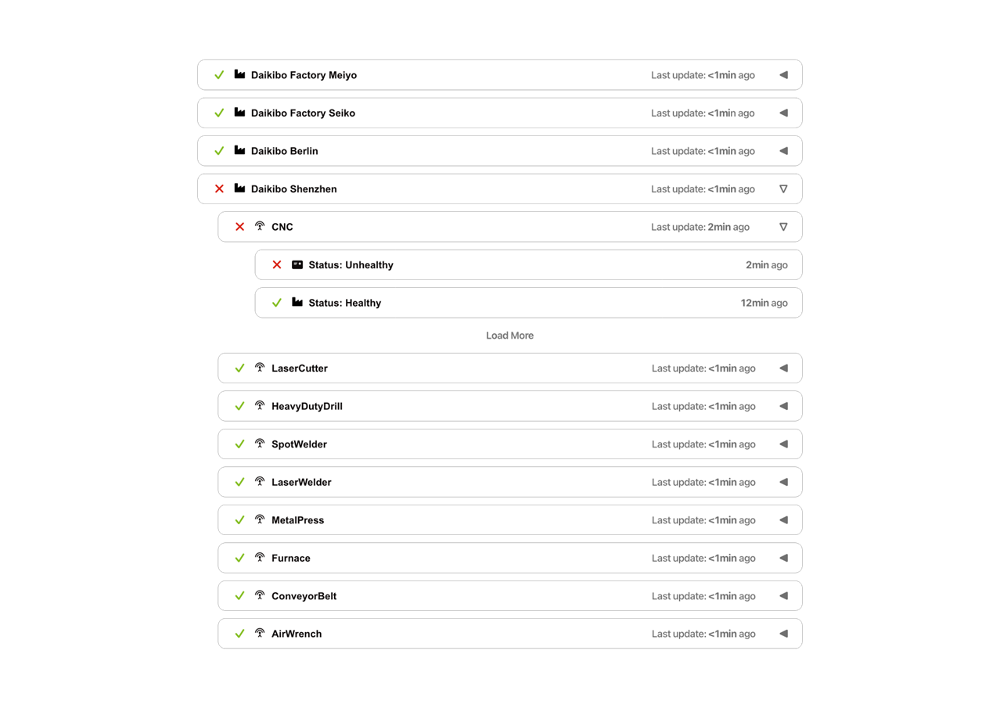

# Software Development Proposal
## Real-Time Manufacturing Status Dashboard for Daikibo Industries

---

## 1. Overview

This proposal outlines the development of a private, real-time manufacturing status dashboard for Daikibo Industries. The system will provide comprehensive visibility into the operational health of all manufacturing equipment across Daikibo's four global factories.

The proposed solution is a secure, intranet-accessible web application that displays the current status of 36 monitored devices (9 machines per factory across 4 locations). The dashboard will integrate with Daikibo's existing telemetry infrastructure and internal authentication server, ensuring seamless access for authorized personnel while maintaining strict security protocols.

This real-time monitoring solution will enable operations managers and maintenance teams to quickly identify equipment issues, track historical performance patterns, and respond proactively to potential failures—ultimately reducing downtime and improving overall manufacturing efficiency.

---

## 2. Scope

The manufacturing status dashboard will deliver the following core functionality:

### 2.1 Real-Time Status Monitoring
- Display current operational status for all 36 devices across 4 factories (Meiyo, Seiko, Berlin, and Shenzhen)
- Visual indicators showing healthy (green checkmark) or unhealthy (red X) status for each device and factory
- Automatic updates reflecting the latest telemetry data with timestamp information
- Clear device identification with machine type icons and names

### 2.2 Hierarchical View Structure
- **Factory-level view**: Collapsible sections for each of the 4 manufacturing facilities
- **Device-level view**: Expandable entries displaying individual machine status within each factory
- Intuitive expand/collapse controls using arrow indicators
- Factory-wide health status aggregation showing overall facility performance

### 2.3 Status History
- Historical status timeline accessible through expandable device views
- "Load More" functionality to retrieve additional historical data points
- Timestamp tracking showing when each status was recorded
- Chronological display of status transitions (healthy/unhealthy)

### 2.4 Security and Authentication
- Integration with Daikibo's internal authentication server
- Single sign-on (SSO) capability using existing company-wide user accounts
- Intranet-only access with no external network exposure
- Role-based access control for authorized personnel only

### 2.5 User Interface Design
The wireframe below illustrates the proposed dashboard layout:

**Key UI Elements:**
- Clean, minimalist interface optimized for quick status assessment
- Responsive design accommodating various screen sizes and resolutions
- Color-coded status indicators for at-a-glance health assessment
- Consistent typography and spacing for improved readability
- Single-page application architecture eliminating navigation complexity

---

## 3. Estimate

The total estimated effort for this project is **480 man-hours**, broken down as follows:

### 3.1 Development (320 hours)
- **Frontend Development** (160 hours)
  - UI component implementation (80 hours)
  - Collapsible/expandable functionality (40 hours)
  - Real-time data updates and WebSocket integration (40 hours)

- **Backend Development** (120 hours)
  - RESTful API development for telemetry data retrieval (60 hours)
  - Authentication server integration (40 hours)
  - Database schema design and implementation (20 hours)

- **Infrastructure Setup** (40 hours)
  - Intranet deployment configuration (20 hours)
  - Real-time data pipeline setup (20 hours)

### 3.2 Testing (120 hours)
- Unit testing for frontend and backend components (50 hours)
- Integration testing with authentication server and telemetry systems (40 hours)
- User acceptance testing (UAT) with Daikibo stakeholders (20 hours)
- Performance and load testing (10 hours)

### 3.3 Integration (40 hours)
- Integration with existing telemetry collection infrastructure (20 hours)
- Authentication server configuration and testing (15 hours)
- Final deployment to production intranet environment (5 hours)

**Total: 480 man-hours**

---

## 4. Timeline

The project will be executed over a 12-week period with the following milestones:

1. **September 1, 2024** – Project kickoff and design phase begins
   - Requirements gathering and stakeholder alignment
   - Wireframe finalization and design approval

2. **September 15, 2024** – Development sprint 1 begins
   - Backend API development starts
   - Authentication integration initiated

3. **October 1, 2024** – Development sprint 2 begins
   - Frontend UI component development
   - Real-time data pipeline implementation

4. **October 15, 2024** – Integration phase begins
   - Telemetry system integration
   - End-to-end testing on staging environment

5. **November 1, 2024** – Testing and quality assurance
   - Comprehensive testing across all modules
   - User acceptance testing with key stakeholders
   - Bug fixes and performance optimization

6. **November 15, 2024** – Production deployment
   - Final deployment to intranet production environment
   - User training and documentation handover
   - Go-live and monitoring

7. **November 22, 2024** – Project completion and handoff
   - Post-deployment review
   - Knowledge transfer to Daikibo IT team

---

## 5. Support

Our commitment to Daikibo extends beyond the initial deployment. We provide comprehensive ongoing product support to ensure the dashboard continues to deliver value:

### 5.1 Continuous Maintenance
- **Bug Fixes**: Rapid response to any issues identified post-deployment with SLA-based resolution times
- **Performance Monitoring**: Proactive monitoring of system performance and uptime
- **Security Updates**: Regular security patches and updates to maintain compliance with industry standards

### 5.2 Support Services
- **Dedicated Support Channel**: Access to our technical support team via email and ticketing system
- **Response Times**:
  - Critical issues: 4-hour response time
  - High-priority issues: 24-hour response time
  - Standard requests: 48-hour response time
- **Documentation**: Comprehensive user and technical documentation with regular updates

### 5.3 Enhancement Opportunities
- **Feature Requests**: Transparent process for requesting new functionality
- **Quarterly Reviews**: Regular check-ins to assess system performance and identify improvement opportunities
- **Technology Updates**: Recommendations for technology stack upgrades and modernization

### 5.4 Support Package Options
We offer flexible support packages tailored to Daikibo's needs, including monthly retainer arrangements for ongoing development and dedicated support hours for future enhancements such as:
- Additional telemetry metrics visualization
- Mobile application development
- Advanced analytics and predictive maintenance features
- Integration with additional factory locations

Our team is committed to being a long-term technology partner, ensuring the dashboard evolves with Daikibo's manufacturing operations and continues to drive operational excellence.

---

**Prepared by:** Deloitte Technology Consulting Team
**Date:** March 25, 2026
**Valid Until:** June 25, 2024
