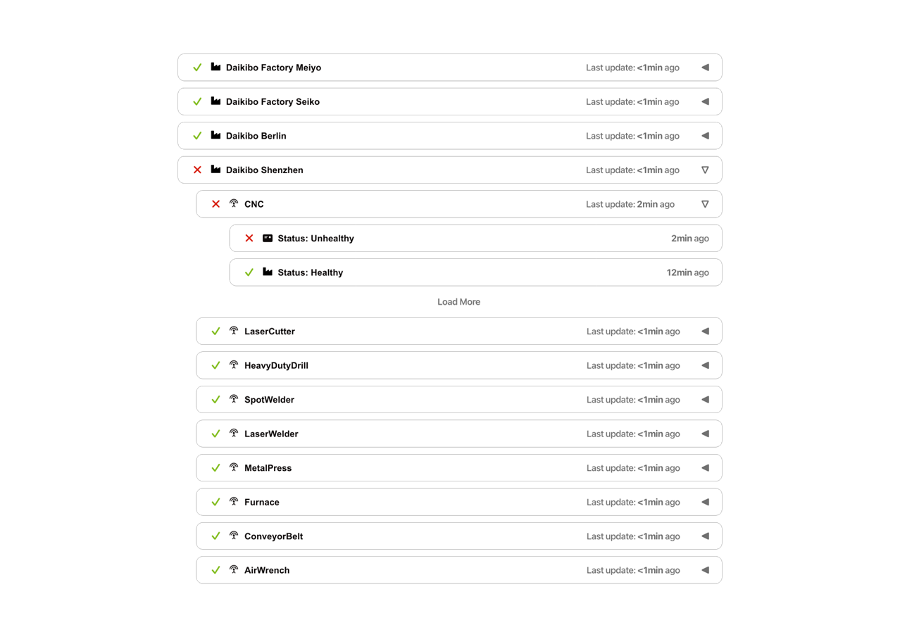

 
1. Overview

[Write an overview of the project]
 
2. Scope

[Describe the project’s scope with all the features it will have. Use the wireframe image on the next page] 

 
3. Estimate

[An estimate of the total number of man-hours needed to get this project done + a breakdown of those hours into development, testing, and integration of the product in the client’s intranet] 
4. Timeline

1.	[1st of September 2024] Design starts
2.	… [Finish the timeline] 
5. Support

[Describe our ability to continuously support the product built in this project]
